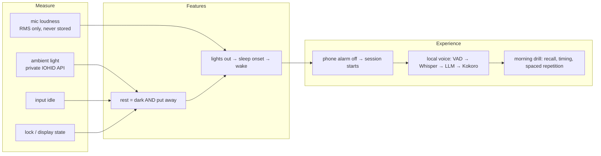

# bedside

A MacBook that notices when you fall asleep, and talks to you when you wake up. No camera, no wearable, no audio recording.

I built this for myself: a laptop on my desk estimates when I fell asleep from light, input and room loudness, and when I turn off my phone alarm it starts a short spoken English session (conversation at night, a vocabulary drill in the morning) through a local voice pipeline. This repo pulls out the parts that stand on their own.

It is a small, real instance of a pipeline I care about for brain–computer interfaces: **measure → features → experience**, with latency, privacy and failure modes taken seriously.

## What's here

| folder | what | run |
|---|---|---|
| [`sensors/`](sensors/) | `room_sensor.swift`: ambient light (lux), input idle, lock and display state as JSON lines | `swiftc -O -target arm64-apple-macos14.0 room_sensor.swift -o room-sensor && ./room-sensor 30` |
| [`inference/`](inference/) | `sleep_onset.py`: lights-out, sleep onset and wake from a night of samples, with tests built from nights that broke earlier versions | `cd inference && python3 -m unittest test_sleep_onset` |
| [`voice/`](voice/) | `voice_server.py`: a local voice server that speaks the same WebSocket protocol as Gemini Live, so a client can switch between them by URL. Speech end by loudness → Whisper (MLX) → Claude Code CLI or any local OpenAI-compatible model → Kokoro TTS. Plus a deterministic **drill mode** (no LLM): Korean cue → spoken English recall → graded with response time | `uv run --script voice/voice_server.py`, then `uv run --script voice/drill_selftest.py ws://127.0.0.1:PORT plan.json` |

Code comments are partly in Korean; this README is the English map.

## Results (one bedroom, one person, honest numbers)

- **Light threshold:** lights on ≈ 390 lux; lights off with the screen still on 10–35 lux → "dark" below 50.
- **Sleep onset vs. what I reported the next morning:** +6 min and +5 min on two nights; "about right" on two more. Small n.
- **Voice latency (first sound after I stop talking):** 1.0–3.8 s for the local pipeline (Whisper + LLM + Kokoro), vs. ~0.6 s for Gemini Live.
- **Drill response time:** in a synthetic test where the "speaker" answers 1.2 s after the prompt finishes, the server measured 1.1 s. It estimates when the client finished playing audio, since playback happens on the other side of the socket.
- **Morning conversation didn't work, the drill did:** six morning free-talk sessions averaged 2.8 utterances from me (half asleep, drifting into Korean). Twelve bedtime chats averaged 12.9. So mornings became a 10-minute structured drill instead.

## What broke, and what fixed it

Most of the design is the residue of these.

1. **The light sensor goes silent when the display sleeps.** The first night never saw "dark", so no sleep was detected. Fix: no lux + locked/display off counts as dark.
2. **A laptop in a backpack looks exactly like sleep** (dark, locked) — it once produced a sleep onset at 20:50 in a library. Fix: if the recording has a gap over 3 minutes, the Mac itself was asleep (lid closed). Never join rest across it.
3. **A Mac left locked at home all day produced a "sleep onset" at 15:13** and an alarm at midnight. Fix: a sleep run must start at night and within 30 minutes of the person actually using the Mac.
4. **Turning on macOS voice processing (echo cancellation) silently killed the microphone** on this Mac with an external speaker: 0.2 s of audio delivered in 6 s, found with a separate mic probe. Every test had used audio files, so none caught it. Fix: echo cancellation off by default; the mic is gated while the coach speaks.
5. **Rebuilding the app at night broke the mic.** Ad-hoc code signatures change every build, so macOS asks for mic permission again. On a locked screen the prompt can't appear, and the audio engine then hangs in `coreaudiod`. Fix: sign with a stable development certificate; never rebuild on a locked night without checking permission.
6. **The external monitor kept waking up at 3 a.m.** `pmset -g log` showed display wakes tagged `VoiceTriggered`: Siri was hearing its own name in room sound and in my bedtime voice chat. Fix: no Siri on the lock screen.
7. **"Ready" was transcribed as Catalan, Spanish and Danish** when Whisper auto-detected the language of a one-word answer — 80 seconds lost before a drill could start. Fix: transcribe in English with a hint, plus one Korean pass.
8. **Short answers vanished.** The speech detector dropped anything under 0.35 s, which is most of "Ready." Fix: 0.12 s minimum in drill mode.
9. **The grader was too strict for speech recognition.** The first real drill scored 2/10, but much of that was the recognizer, not me ("denoise" → "denounce", "email the lab members" → "Metal Blanc members"). Fix: pass the expected key words to Whisper as a prompt, and add a "close" grade. It requires every content word of the key phrase to be similar, and it advances the review schedule less than a clean answer.

## Privacy by design

- No audio is ever written to disk. The sensor keeps only loudness statistics; transcription happens in memory.
- Sensing, sleep inference, speech recognition, speech synthesis and the drill all run locally. Only a conversation turn's text goes to an LLM, and only if the cloud model is chosen.
- The wake-word listener throws away any utterance that isn't the wake word, without writing it down.

## Not proven

- One person, one room, a handful of nights. The onset numbers are self-report vs. a rule, not polysomnography.
- "Room got louder than its background" is a crude proxy for movement.
- The drill's effect on vocabulary or memory is untested; that's the point of logging every answer and response time.

## Why

I'm heading toward brain–computer interfaces for live performance. Before there's a sensor on anyone's head, the same questions show up here at small scale: what can a cheap signal honestly tell you, how fast does the loop have to be, what does a person actually experience, and what happens to the data. The companion notebook, [Can one hear the shape of a brain?](https://github.com/ecce-mys/shape-of-a-brain), works through the math on the measurement side.
